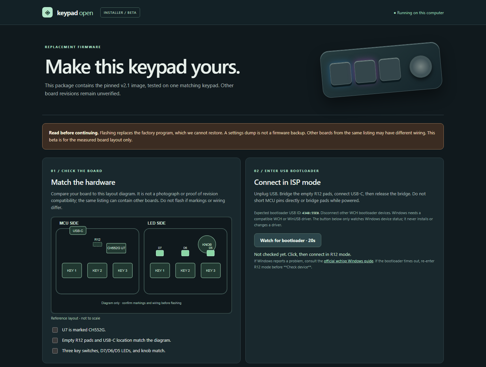
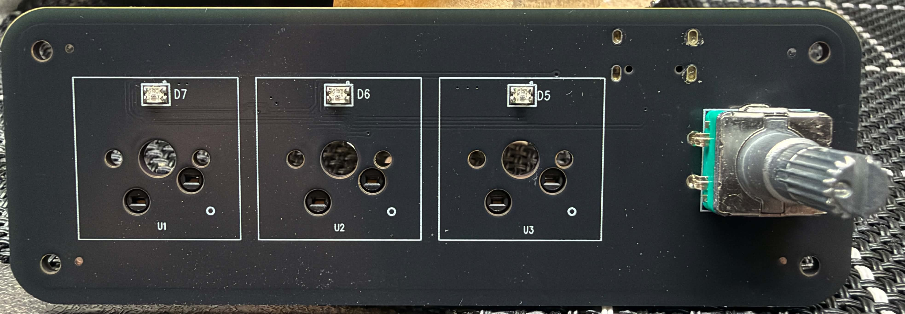
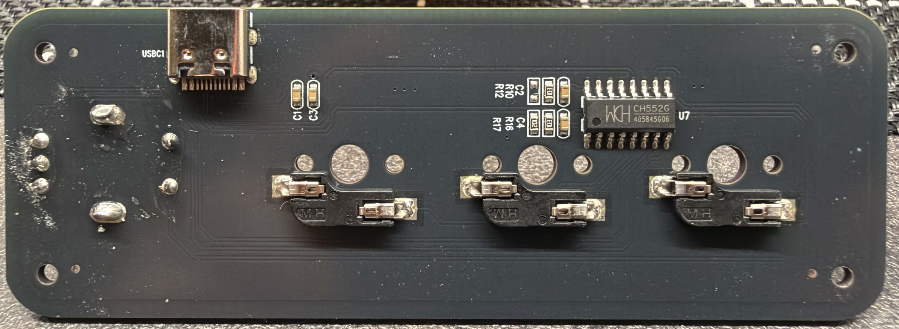

<h1 align="center">KeypadOpen</h1>

Your three-key keypad, opened up. Custom firmware, a guided local flasher, and more ways to use the keys, knob, and lights.

**Beta:** KeypadOpen v2.1 has been tested on one matching CH552G board, not on every keypad sold under the same listing. Flashing erases the factory program, and we do not have a restorable factory firmware image. Read the [board reference](docs/HARDWARE.md) before continuing.

<a href="https://github.com/jonassvidras/keypad-flasher/releases/download/v2.1.0-beta.1/KeypadOpen-v2.1-Windows11.zip"><strong>Download for Windows 11</strong></a> · <a href="https://github.com/jonassvidras/keypad-flasher/releases/tag/v2.1.0-beta.1">Release notes and checksums</a>

The local Windows installer walks through four steps. Click for the full view.

## Windows 11

1. Compare your PCB with the [board photos](#board-photos) and [board reference](docs/HARDWARE.md). Do not flash a look-alike board or a different MCU.
2. Download `KeypadOpen-v2.1-Windows11.zip` from the [beta release](https://github.com/jonassvidras/keypad-flasher/releases/tag/v2.1.0-beta.1). Extract it, keep all files together, and run `KeypadOpenInstaller.exe`.
3. Follow its four steps: match the board, enter R12 bootloader mode, run the read-only check, then explicitly approve erase/flash/verify. Wait for **Verify OK** before reconnecting normally.

The installer never changes USB drivers. It can optionally download a checksum-pinned `wchisp` from its [upstream project](https://github.com/ch32-rs/wchisp); that tool is not bundled. The Windows app is unsigned, so Windows may ask you to confirm before opening it. See the [Windows package guide](firmware/flasher/WINDOWS_PACKAGE.md) if bootloader detection fails.

After flashing, use [Keypad Studio](https://github.com/jonassvidras/keypad-studio) to assign keys, shortcuts, media controls, clicks, scrolling, and 12 lighting modes. Settings save on the keypad.

## Board photos

These show the one tested board. Click to enlarge; matching its appearance alone does not verify the wiring.

| Front PCB | Back PCB |
| :---: | :---: |
|  |  |

## For builders

The pinned v2.1 image is `firmware/release/KeypadOpen-v2.1.hex` (SHA-256 `c7ff2e8d5d3b9615ec0a1f9307173dfcb66c2a18de5e9dc56d72a9e5eda9c8f6`). Its Intel HEX records match the owner-tested build; only text line endings changed. It cannot restore factory firmware. The [source bundle](https://github.com/jonassvidras/keypad-flasher/releases/download/v2.1.0-beta.1/KeypadOpen-v2.1-source.zip) includes CH55xDuino 0.0.25 and our build changes. Source and Windows build instructions are in `firmware/KeypadOpen/` and `firmware/build.ps1`. CH55xDuino retains its LGPL-2.1 license. The optional `wchisp` tool also remains under its [upstream license](https://github.com/ch32-rs/wchisp/blob/main/LICENSE) and is not included here.

The firmware retains CH55xDuino's shared `1209:C55D` USB ID. Other devices using that ID may conflict with its Windows driver association; check the device and driver before flashing. Our original source is [MIT licensed](LICENSE); [third-party components](THIRD_PARTY.md) keep their own licenses. This repository is separate from Keypad Studio and contains no factory firmware backup.

## Help improve it

This is the final owner-tested build; broader hardware compatibility has not been verified. [Issues and pull requests](https://github.com/jonassvidras/keypad-flasher/issues) are welcome. When reporting another board, share clear PCB markings and the exact failure, but do not post chip UIDs, serial numbers, or logs containing personal paths. Never flash an unverified board to test compatibility.
